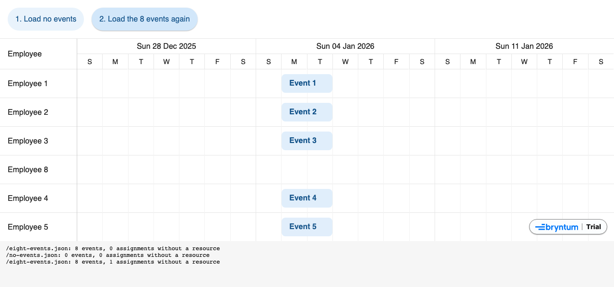

# Lazy-loaded project: reloading after an empty load paints one bar fewer

Minimal repro for [support#13943](https://github.com/bryntum/support/issues/13943) (closed as fixed in 7.3.8) and the
[forum thread](https://forum.bryntum.com/viewtopic.php?f=44&t=35740). Still reproduces on **8.0.0 and 8.0.2**.
Scheduler (`@bryntum/scheduler-enterprise`), plain JS + Vite, the stock `AjaxTransport` reading two static JSON files.
Bryntum 8 is on the public npm registry: if your `@bryntum` scope still points to npm.bryntum.com, install with `npm install --@bryntum:registry=https://registry.npmjs.org`.

## Run

```sh
npm install
npm run dev
```

Open the URL Vite prints. 8 resources, 8 events, one per resource.

1. Click **1. Load no events**. The project loads `no-events.json`: 7 resources, no events. The view is empty.
2. Click **2. Load the 8 events again**. The project loads `eight-events.json`: the same 7 resources plus a new one
   (id 8) in the middle of the list, one event each.

Only 7 bars come back, out of 8. The log shows 8 events and 1 assignment without a resource: the event of the
resource inserted in the middle. That resource is in the store and its row is drawn, without its bar.



`npm run repro` (in a second terminal) clicks both buttons headless and prints the bar counts.

## What changes the result

- Remove `lazyLoad: true`: all 8 bars come back.
- Same 7 resources in both loads (no row inserted by the second one): all bars come back. This is why the first repro
  (7.3.7, same resources in both files) looked fixed in 8.x: it exercised only the case of an unchanged row list.
- Reload through `project.resourceStore.load()` instead of `project.load()`: same result.

In our app (Planning, Areas view) it is the same gesture: an empty month, then Today, where the full month brings one
more area than the empty one. Without our workaround one area row stays without its bar on every try; with it, all
rows are drawn.

## Workaround we use

After the load, relink the orphans and repaint:

```js
for (const assignment of project.assignmentStore.records.filter(a => !a.resource)) {
    assignment.resource = assignment.resourceId;
}
await project.commitAsync();
scheduler.refreshRows();
```

Is this a bug, or is there a setting we are missing?
